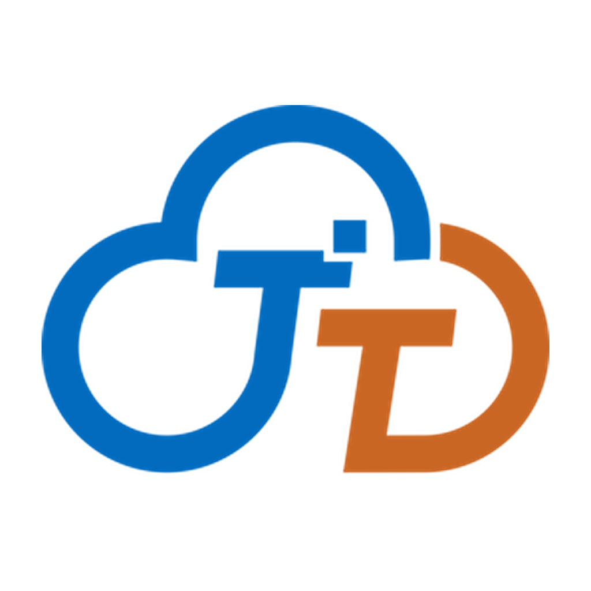

<div align="center">
  
  <h1>Act-Freely</h1>
  <p>A local-first AI office workbench — General / Design / Slides modes, from conversation to execution to deliverable</p>
  <p>English · <a href="README.md">简体中文</a></p>
</div>

---

## What it is

Act-Freely is an AI office workbench that runs on the desktop. It keeps a single path from "describe the task" to "get the deliverable": the UI is a local Tauri + React app, execution runs in a bundled Python agent engine, and accounts, skill / suite / MCP marketplace and project collaboration live in a separate FastAPI server.

What makes it different from a plain chat client:

- **Deliverable-oriented**: tasks can produce real files — single-file HTML prototypes, `.xlsx` dashboards, `.docx` reports, `.pptx` decks — not just a paragraph of text.
- **Local-first**: conversations, knowledge bases, memory and artifacts stay in local data directories by default; model keys go to the OS keychain and never into the repository.
- **Inspectable execution surface**: terminal, browser, computer use and remote desktop run under explicit grants; high-risk actions require approval, and tool grants and hooks can be revoked at any time.

> Some modules still use the project's early name "通天办公" (Tongtian Office). They refer to the same product.

## Highlights

- **Three work modes**: General, Design and Slides, each with its own canvas and artifact handling. Design mode ships 9 curated showcases and task templates (real cover images + directly runnable prompts); they are hidden in General and Slides.
- **Task execution and replay**: the agent streams plan / step / deliver events; SSE events carry a monotonic `seq` and support reconnection replay. Task monitor and canvas are paginated, and send/stop is a single button.
- **Experts, skills and marketplace**: expert suites, skill packs and MCP connectors can be searched, downloaded and bookmarked from the online marketplace; installs are statically scanned for risk and publisher signatures can be verified.
- **Knowledge, memory and awareness**: the local knowledge base supports ranking and title recall; `SOUL.md` / `WORK_MANUAL.md` / `USER_PROFILE.md` / `MEMORY.md` define collaboration style and long-term memory.
- **Execution surface**: terminal (including ACP), browser use, computer use, remote desktop, scheduled tasks and hooks — all constrained by a sandbox.
- **Model hub**: multiple model profiles, per-task routing and failover, cost / latency ledger; zero-config detection of a local Ollama installation.
- **Accounts and security**: loopback web-verified login, OS keychain for secrets, tool grants and approvals, privacy guard, static risk scanning.
- **IM channels**: Slack, DingTalk, WeCom and Feishu long connections (real enterprise app credentials required).
- **Bilingual UI**: switch between 中文 and English in Settings; dates and copy follow the selected language.

## Architecture

```text
┌──────────────────────────────────────────────────────────────┐
│ Renderer  React 18 + MUI 5 + Zustand + HashRouter             │
│ Workbench / Design canvas / Knowledge / Suites / Extensions   │
└───────────────┬──────────────────────────────────────────────┘
                │ Tauri IPC (invoke / event)
┌───────────────▼──────────────────────────────────────────────┐
│ Tauri 2 core (Rust)                                           │
│ AgentBridge · file/knowledge/skill stores · auth & keychain   │
│ security · browser/computer/remote · plan & event store       │
└───────────────┬──────────────────────────────────────────────┘
                │ HTTP + SSE (local loopback)
┌───────────────▼──────────────────────────────────────────────┐
│ Python agent engine (FastAPI + AgentScope)                    │
│ ReAct loop · tools · sandbox · context compaction · IM · usage│
└───────────────┬──────────────────────────────────────────────┘
                │ REST
┌───────────────▼──────────────────────────────────────────────┐
│ tongtian-server (FastAPI + SQLite WAL)                        │
│ accounts · skill/suite/MCP marketplace · collaboration        │
└──────────────────────────────────────────────────────────────┘
```

- **Renderer**: pages and components in `src/renderer`; cross-process contracts and pure logic in `src/shared`.
- **Rust core**: registers 170+ Tauri commands and owns process/file boundaries, engine bridging, security policy and local storage.
- **Python engine**: talks to the Rust bridge over HTTP + SSE and runs the agent loop and tool calls; shipped as an embeddable Python runtime in release builds.
- **Server**: only accounts, marketplace and collaboration — it never receives desktop conversations, file contents or credential values.

## Repository layout

```text
.
├── tongtian-tauri/            # Desktop app
│   ├── src/renderer/          # React renderer (pages / components / i18n)
│   ├── src/shared/            # Shared contracts and pure logic
│   ├── src-tauri/             # Rust core (commands, bridge, stores, security, native)
│   ├── engine/                # Python agent engine (FastAPI + AgentScope)
│   ├── scripts/               # prepare-python.sh, mock-agent.py, tt-cli.mjs
│   ├── tests/                 # Vitest unit/integration tests + engine self-tests
│   ├── deploy/                # Service deployment & CLI notes (with unverified items)
│   └── init.sh                # Desktop setup and launch script
├── tongtian-server/           # Account & marketplace server (FastAPI + SQLite)
│   ├── app/                   # Routes, storage, auth and marketplace logic
│   ├── tests/                 # End-to-end and unit tests
│   └── init.sh                # Server setup and launch script
├── docs/                      # Specs, change records, capability ledger, gap list
├── image/                     # Brand assets
├── LICENSE / NOTICE
└── README.md / README.en.md
```

## Getting started

### Requirements

| Component | Requirement | Notes |
| --- | --- | --- |
| Node.js | 20+ | Frontend build and Tauri CLI |
| Rust | stable | Only needed for the desktop shell; `init.sh` falls back to browser mode without it |
| Python | 3.10+ | Engine and server |
| OS | Windows 10/11 + WebView2 | Primary tested platform; macOS / Linux are unverified in this repository |
| Shell | Git Bash | Both `init.sh` scripts are Bash |

### 1. Start the server (accounts / marketplace / collaboration)

```bash
cd tongtian-server
cp .env.example .env    # optional: adjust port, secrets, admin account
bash init.sh
```

Default endpoints:

| Entry | URL |
| --- | --- |
| Service root | `http://127.0.0.1:8000/` |
| Swagger UI | `http://127.0.0.1:8000/docs` |
| Health check | `http://127.0.0.1:8000/health` |

In development `init.sh` seeds demo data by default (`TT_SEED_DEMO=true`, idempotent, never overwriting existing rows); the demo password is printed once on first creation. See [tongtian-server/README.md](tongtian-server/README.md) for configuration and APIs.

### 2. Start the desktop app

```bash
cd tongtian-tauri
bash init.sh
```

`init.sh` checks Node / Rust / Python, installs missing dependencies, and prints access information before blocking:

- With Rust: launches `npm run tauri dev` and opens the desktop window.
- Without Rust: falls back to the browser frontend at `http://localhost:7173` (frontend self-test only).
- Defaults are `MOCK_ENABLED=true` (frontend commands use local mocks) and `TT_AUTH_MOCK=false` (login uses the real server). Set `MOCK_ENABLED=false` to exercise all real backend capabilities; set `TT_AUTH_MOCK=true` for fully offline development.

Or start manually:

```bash
cd tongtian-tauri
npm install
npm run tauri dev      # desktop shell
npm run dev            # browser frontend only, port 7173
```

### 3. Configure a model

The engine reads the default model from `tongtian-tauri/.env` (you can also configure it in the in-app Model Hub, where keys go to the OS keychain):

```dotenv
TT_PROVIDER=dashscope
TT_MODEL=qwen-plus
TT_API_KEY=your-key
TT_BASE_URL=
```

Model names, quotas and pricing follow each vendor's console. If Ollama is installed locally, no cloud model is required.

### 4. Build installers

```bash
cd tongtian-tauri
bash scripts/prepare-python.sh    # run before the first release build
npm run tauri build
```

Artifacts land in `src-tauri/target/release/bundle/` (`msi/` and `nsis/` on Windows). `prepare-python.sh` only handles Windows embeddable amd64; without the bundled runtime the installer still launches but the engine is unavailable. The first build downloads the WiX / NSIS toolchains — offline environments must pre-populate caches named exactly `WixTools314` / `NSIS`.

## Modes and switches

| Variable | Default | Effect |
| --- | --- | --- |
| `MOCK_ENABLED` | `true` | Whether frontend commands use local mocks; `false` calls real Tauri commands |
| `TT_AUTH_MOCK` | `false` | `true` simulates login offline without contacting the server |
| `TT_AUTH_SERVER_URL` | `http://127.0.0.1:8000` | Account service used by the desktop app |
| `TT_SEED_DEMO` | `true` in `init.sh` | Whether the server idempotently seeds demo data |
| `TT_ENGINE_TOKEN` | empty | Engine access token for service deployments; not needed for desktop loopback |

## Testing

```bash
# Frontend: typecheck + Vitest (unit + TS integration)
cd tongtian-tauri
npm run typecheck
npm run test

# Rust unit tests
cd src-tauri
cargo test --lib

# Server (stdlib tests, no pytest required)
cd ../../tongtian-server
.venv/Scripts/python.exe tests/test_server.py   # Windows
.venv/bin/python tests/test_server.py            # macOS / Linux
.venv/Scripts/python.exe tests/test_units.py
```

`tongtian-tauri/tests/integration/engine_*_selftest.py` are engine capability self-tests; run them individually as needed (some require external credentials or a local browser, and skip or fail honestly when those are missing).

## Data and configuration

| Location | Contents |
| --- | --- |
| `TONGTIAN_HOME` (defaults to `%APPDATA%\tongtian-office`, or `~/.tongtian` off Windows) | Workspaces, artifacts, model profiles, task events |
| `TONGTIANWORK_HOME` (defaults to `~/.tongtianwork`) | Awareness files, knowledge bases, browser-specific data |
| `tongtian-tauri/.env` | Engine default model (`TT_PROVIDER` / `TT_MODEL` / `TT_API_KEY` / `TT_BASE_URL`) |
| `tongtian-server/.env` | Server bind address, JWT secret, demo data, etc. |
| `tongtian-server/storage/` | SQLite database and marketplace package files |

## Current boundaries

This project is under active development. The following are not delivered capabilities yet:

- **Service deployment**: engine + static frontend + token flow is verified locally; `deploy/Dockerfile`, real reverse proxies, TLS and public SSE long connections are unverified. See [tongtian-tauri/deploy/README.md](tongtian-tauri/deploy/README.md).
- **IM channels**: Slack / DingTalk / WeCom / Feishu have only been verified against local fake servers; real enterprise credentials and production behavior are not accepted yet.
- **Cross-platform**: the desktop app is primarily developed and verified on Windows; macOS / Linux builds, bundled Python and installers are unverified.
- **Full gap list**: see the [capability ledger](docs/changes/project-gap-analysis/能力台账-2026-10-19.md) and [unimplemented list](docs/changes/project-gap-analysis/未实现清单-2026-10-20.md); this README does not duplicate them.

## Security notes

- Never commit `.env`, model keys, enterprise app credentials, or any verification script containing a real key.
- `tongtian-tauri/tests/test.py` is a local scratch script containing a plaintext API key. It is git-ignored and has never been committed; the key itself must be revoked / rotated.
- Run a secret scan before pushing anywhere; if a leak is found, rotate the credential instead of only deleting the file.

## Contributing

Issues and pull requests are welcome at [GitHub Issues](https://github.com/zzw521/Act-Freely/issues). Before submitting, make sure `npm run typecheck`, `npm run test` and the relevant Rust / server tests pass, and keep local data, session logs and credentials out of the commit.

## License

Released under the [Apache License 2.0](LICENSE). Portions are derived from the QwenPaw project (Apache-2.0); attribution and derived scope are documented in [NOTICE](NOTICE).

© 2026 Beijing Tongtian Cloud Computing Co., Ltd.
