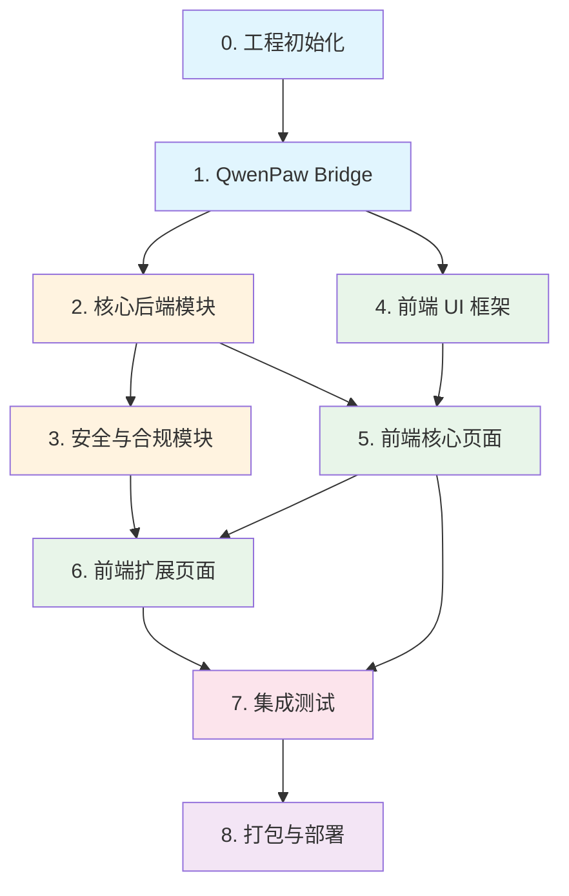

# 通天办公 · QwenPaw 集成实施任务清单

> **变更名称**：`qwenpaw-integration`  
> **输入规格**：`docs/spec/spec-通天办公-qwenpaw-改造方案.md` + `docs/spec/spec-通天办公.md`  
> **能力域 Specs**：`docs/changes/qwenpaw-integration/specs/*/spec.md`  
> **QwenPaw 本地源码**：`QwenPaw-main/`（已下载到工程根目录）  
> **创建日期**：2026-07-31

---

## QwenPaw 本地源码复用指引

QwenPaw 源码已下载到 `QwenPaw-main/` 目录，实施时可直接参考或复制复用其中的模块代码。

### Python 后端模块（QwenPaw 子进程内复用）

| QwenPaw 模块路径 | 核心文件 | 通天办公复用方式 | 说明 |
|-----------------|---------|:---------------:|------|
| `src/qwenpaw/providers/` | `provider.py`, `provider_manager.py`, `openai_provider.py`, `ollama_provider.py`, `dashscope_provider.py`, `retry_chat_model.py`, `rate_limiter.py` | **直接复用** | 14+ 供应商适配器，OpenAI 兼容协议，重试/限流已内置 |
| `src/qwenpaw/agents/react_agent.py` | `react_agent.py` (1005行) | **直接复用** | ReAct 循环核心实现，Agent 引擎基础 |
| `src/qwenpaw/agents/skill_system/` | `hub.py`, `registry.py`, `pool_service.py`, `store.py` | **直接复用** | SKILL.md 解析、技能注册、依赖解析、安全审计 |
| `src/qwenpaw/agents/acp/` | `client.py`, `server.py`, `service.py`, `tool_adapter.py` | **直接复用** | ACP 委派协议实现 |
| `src/qwenpaw/agents/memory/` | `base_memory_manager.py`, `agent_md_manager.py`, `reme_light_memory_manager.py` | **直接复用** | 三层记忆系统（MEMORY.md 长期 + 每日记忆 + 语义搜索） |
| `src/qwenpaw/tool_calls/` | `_coordinator.py` (1015行), `_timeout_helper.py` | **直接复用** | 工具调用协调器、超时控制、中间件链 |
| `src/qwenpaw/sandbox/` | `windows_sandbox.py` (1656行), `windows_restricted_sandbox.py` (3368行), `config.py` | **直接复用** | Windows 沙箱实现（Job Object + 受限令牌），与通天办公 L0/L1 沙箱互补 |
| `src/qwenpaw/security/` | 安全模块 | **直接复用** | 四层安全体系（工具防护/文件控制/技能扫描/权限审批） |
| `src/qwenpaw/token_usage/` | Token 用量统计 | **直接复用** | Token 计数和统计 |
| `src/qwenpaw/config/` | 配置系统 | **直接复用** | 工作区配置、JSON + Markdown 存储 |
| `src/qwenpaw/runtime/` | 运行时管理 | **直接复用** | 进程生命周期管理 |
| `src/qwenpaw/app/` | FastAPI 应用入口 | **参考 API 设计** | HTTP API 路由定义，通天办公 Bridge 层需对齐其接口 |

### 前端参考资源（QwenPaw Console）

| QwenPaw Console 模块路径 | 通天办公复用方式 | 说明 |
|-------------------------|:---------------:|------|
| `console/src/stores/messageQueueStore.ts` (654行) | **高价值参考** | 消息排队/跨窗口同步/持久化恢复设计模式 |
| `console/src/hooks/useWorkspaceWatch.ts` | **参考实现** | SSE 解析/单例连接管理/自动重连/扇出分发 |
| `console/src/hooks/useToolCallControl.ts` | **参考实现** | 工具调用前端控制（取消/延长/后台化） |
| `console/src/hooks/useProgressiveRender.ts` | **可复用逻辑** | 大量消息虚拟化渲染优化 |
| `console/src/api/types/` (18个类型文件) | **参考 IPC 契约** | 完整 AI Agent 产品数据模型定义 |
| `console/src/stores/agentStore.ts` | **参考实现** | 多 Agent 切换状态管理 |
| `console/src/stores/loopStore.ts` | **参考实现** | ReAct 循环前端状态追踪 |

### 裁剪不取的模块

| QwenPaw 模块路径 | 裁剪原因 |
|-----------------|----------|
| `src/qwenpaw/cli/` (31 文件) | 桌面产品不需要 CLI 入口 |
| `src/qwenpaw/tauri/` | 通天办公用 Electron，不用 Tauri |
| `console/` (整个前端) | 通天办公有独立 React UI |
| `plugins/channel/azure_bot/` | 首版不需要 Azure Bot 频道 |
| `src/qwenpaw/tunnel/` | 不需要隧道能力 |
| `src/qwenpaw/local_models/` | 通天办公通过 Ollama 接入本地模型，不需要内置本地推理 |

---

## 并行执行指南

> **关键约束**：通天办公为单一 Electron 应用（前端 + 主进程同属一个项目），所有任务 **必须串行执行**，不可并行。  
> 原因：前端渲染层、主进程后端层、QwenPaw Bridge 层之间存在紧密的 IPC 契约依赖，任何并行修改都可能导致接口不一致。

| 任务组 | 可并行？ | 原因 |
|--------|:--------:|------|
| 0. 工程初始化 | ❌ 串行 | 基础设施，所有后续任务依赖 |
| 1. QwenPaw Bridge | ❌ 串行 | 核心通信层，Agent/UI 依赖 |
| 2. 核心后端模块 | ❌ 串行 | 模块间有 IPC 和数据依赖 |
| 3. 安全与合规模块 | ❌ 串行 | 依赖核心后端模块 |
| 4. 前端 UI 框架 | ❌ 串行 | 依赖 IPC 契约定义 |
| 5. 前端核心页面 | ❌ 串行 | 依赖后端 IPC 实现 |
| 6. 前端扩展页面 | ❌ 串行 | 依赖后端扩展模块 |
| 7. 集成测试 | ❌ 串行 | 依赖全部模块完成 |
| 8. 打包与部署 | ❌ 串行 | 最终阶段 |

---

## 任务依赖图



---

## 0. 技术栈与项目结构

### 技术栈

| 层级 | 技术 | 版本 |
|------|------|------|
| 桌面壳 | Electron | 30.x |
| 前端 | React 18 + TypeScript + MUI 5 + Tailwind CSS 3 | — |
| 状态管理 | Zustand | 4.x |
| 主进程 | Node.js 20 + TypeScript | — |
| 数据库 | better-sqlite3 | 11.x |
| 密钥存储 | keytar | 7.x |
| Schema 校验 | zod | 3.x |
| 测试框架 | Vitest | — |
| E2E 测试 | Playwright + Electron | — |
| 打包工具 | electron-builder | — |
| QwenPaw 引擎 | Python 3.10+ + qwenpaw >= 1.1 | 子进程 |

### 项目结构

```
tongtian-office/
├── electron-builder.yml          # 打包配置
├── package.json
├── tsconfig.json
├── vite.config.ts
├── init.sh                       # 工程初始化脚本
├── src/
│   ├── shared/                   # 前后端共享类型
│   │   ├── types.ts              # 核心类型定义
│   │   └── contracts.ts          # IPC 契约类型
│   ├── main/                     # Electron 主进程
│   │   ├── index.ts              # 主进程入口
│   │   ├── bridge/               # QwenPaw Bridge 层
│   │   │   ├── qwenpaw-bridge.ts
│   │   │   ├── http-client.ts
│   │   │   ├── sse-parser.ts
│   │   │   ├── config-injector.ts
│   │   │   └── version-adapter.ts
│   │   ├── agent/                # Agent 引擎（状态机编排）
│   │   │   ├── engine.ts
│   │   │   ├── state-machine.ts
│   │   │   └── event-adapter.ts
│   │   ├── model/                # Model Hub
│   │   │   ├── hub.ts
│   │   │   ├── router.ts
│   │   │   ├── circuit-breaker.ts
│   │   │   ├── observer.ts
│   │   │   └── adapter/
│   │   ├── file/                 # 文件处理
│   │   │   ├── backup.ts
│   │   │   ├── convert.ts
│   │   │   └── organize.ts
│   │   ├── workspace/            # 工作区管理
│   │   │   ├── manager.ts
│   │   │   └── quota.ts
│   │   ├── sandbox/              # 沙箱管理
│   │   │   ├── sandbox-manager.ts
│   │   │   ├── dangerous-guard.ts
│   │   │   └── quota-controller.ts
│   │   ├── compliance/           # 企业合规
│   │   │   ├── compliance-guard.ts
│   │   │   ├── data-classifier.ts
│   │   │   └── whitelist.ts
│   │   ├── audit/                # 审计日志
│   │   │   ├── audit-logger.ts
│   │   │   └── sanitizer.ts
│   │   ├── schedule/             # 定时任务
│   │   │   └── schedule-manager.ts
│   │   ├── store/                # 持久化
│   │   │   ├── db.ts
│   │   │   ├── vault.ts
│   │   │   └── migrations/
│   │   ├── ipc/                  # IPC Handler
│   │   │   ├── chat.ipc.ts
│   │   │   ├── model.ipc.ts
│   │   │   ├── file.ipc.ts
│   │   │   ├── workspace.ipc.ts
│   │   │   ├── skill.ipc.ts
│   │   │   ├── mcp.ipc.ts
│   │   │   ├── sandbox.ipc.ts
│   │   │   ├── compliance.ipc.ts
│   │   │   ├── audit.ipc.ts
│   │   │   └── schedule.ipc.ts
│   │   └── util/
│   │       ├── crypto.ts
│   │       └── logger.ts
│   ├── preload/
│   │   └── index.ts              # contextBridge 暴露
│   └── renderer/                 # 前端渲染进程
│       ├── App.tsx
│       ├── main.tsx
│       ├── theme/                # 设计主题
│       │   ├── tokens.ts
│       │   └── theme.ts
│       ├── pages/
│       │   ├── Workbench/
│       │   ├── ModelHub/
│       │   ├── SkillMarket/
│       │   ├── WorkspacePanel/
│       │   ├── FilePanel/
│       │   ├── ScheduleView/
│       │   ├── Settings/
│       │   └── AuditView/
│       ├── components/
│       │   ├── Layout/
│       │   ├── PlanView/
│       │   ├── ChatStream/
│       │   └── common/
│       └── stores/
│           ├── useChatStore.ts
│           ├── useModelStore.ts
│           ├── useWorkspaceStore.ts
│           ├── useSkillStore.ts
│           ├── useSettingsStore.ts
│           └── useAuditStore.ts
├── tests/
│   ├── unit/
│   ├── integration/
│   ├── contract/
│   └── e2e/
└── resources/
    └── icon.ico / icon.icns
```

### 参考设计文档

- `docs/spec/spec-通天办公-qwenpaw-改造方案.md` — QwenPaw 改造实施方案
- `docs/spec/spec-通天办公.md` — 通天办公技术规格说明书 v1.1
- `docs/changes/qwenpaw-integration/specs/*/spec.md` — 12 个能力域 spec

---

## 1. 工程初始化与基础设施 (W1)

- [ ] 1.1 创建 Electron + React + TypeScript 项目骨架 (`package.json`, `tsconfig.json`, `vite.config.ts`)
  - 依赖：electron ^30, react ^18, @mui/material ^5, tailwindcss ^3, zustand ^4, better-sqlite3 ^11, keytar ^7, zod ^3
  - 配置 Vite 构建渲染进程，esbuild 构建主进程

- [ ] 1.2 配置 Electron 主进程入口 (`src/main/index.ts`)
  - BrowserWindow 安全配置：`nodeIntegration: false`, `contextIsolation: true`, `sandbox: true`
  - 系统托盘、窗口管理基础

- [ ] 1.3 配置 `contextBridge` 预加载脚本 (`src/preload/index.ts`)
  - 定义 IPC channel 白名单暴露接口
  - 按 `spec-通天办公.md` §5.1 IPC Channel 清单实现类型安全的 invoke/send

- [ ] 1.4 初始化 SQLite 数据库 (`src/main/store/db.ts`)
  - 创建全部表结构（tasks/messages/file_ops/model_configs/audit_logs/workspaces/skills/mcp_servers/sandbox_policies/schedule_tasks/model_usage）
  - 参考 `spec-通天办公.md` §4.3 DDL + schedule_tasks/model_usage 新增表
  - 实现数据库迁移机制

- [ ] 1.5 实现密钥存储 (`src/main/store/vault.ts`)
  - keytar 加密存储 API Key
  - 运行时解密至内存，进程退出自动清除
  - 参考 `spec-通天办公.md` §6.2 密钥生命周期

- [ ] 1.6 实现加密工具 (`src/main/util/crypto.ts`)
  - AES-256-GCM 加解密
  - 密钥派生（用于 API Key 加密）
  - 单元测试覆盖 ≥ 90%

- [ ] 1.7 实现结构化日志 (`src/main/util/logger.ts`)
  - JSON 格式，分级 debug/info/warn/error
  - 写入 `%APPDATA%/tongtian-office/logs/`
  - 脱敏规则：API Key、PII 自动替换为 `[REDACTED]`

- [ ] 1.8 定义共享类型 (`src/shared/types.ts`, `src/shared/contracts.ts`)
  - 所有核心实体类型（Task/Plan/Step/ModelConfig/Workspace/Skill/MCPServer/SandboxPolicy/AuditLog）
  - IPC 请求/响应类型
  - 错误码枚举（含新增 Bridge/Compliance/Schedule 错误码）

- [ ] 1.9 配置 QwenPaw Python 环境
  - 确定 QwenPaw 安装方式（pip install qwenpaw 或 bundled）
  - 编写 Python 环境检测脚本
  - 配置 QwenPaw 工作目录结构 `~/.tongtian/workspaces/{id}/`

- [ ] 1.10 编写 `init.sh` 工程初始化脚本
  - 安装 Node.js 依赖（npm install）
  - 检测/安装 Python 环境和 QwenPaw
  - 初始化 SQLite 数据库
  - 启动开发模式（npm run dev）
  - 打印访问信息和运行模式

---

## 2. QwenPaw Bridge 核心通信层 (W1-2)

> **Spec**：`specs/qwenpaw-bridge/spec.md`

- [ ] 2.1 实现 QwenPaw HTTP 客户端 (`src/main/bridge/http-client.ts`)
  - 基于 Node.js http 模块的 HTTP 请求封装
  - 超时控制（默认 30s）、重试机制（指数退避，最多 3 次）
  - 健康检查接口 `GET /health`

- [ ] 2.2 实现 SSE 事件流解析器 (`src/main/bridge/sse-parser.ts`)
  - 解析 QwenPaw SSE 事件（plan/step_start/step_progress/step_done/step_failed/deliver/done/error）
  - 转换为 `AsyncIterable<AgentEvent>`
  - 异常断线重连

- [ ] 2.3 实现 QwenPaw 子进程管理器 (`src/main/bridge/qwenpaw-bridge.ts`)
  - `startWorkspace()`: spawn Python 子进程 → 分配端口 → 等待健康检查 → 标记 ready
  - `stopWorkspace()`: SIGTERM → 等待 5s → SIGKILL → 释放端口
  - `sendMessage()`: POST /api/chat → SSE 流式响应
  - `callTool()`: POST /api/tools/{name} → ToolResult
  - 异常处理：子进程崩溃 → 标记 error → 通知 UI

- [ ] 2.4 实现配置注入器 (`src/main/bridge/config-injector.ts`)
  - 根据 WorkspaceConfig 生成 QwenPaw 配置文件（JSON）
  - 设置工作目录、模型绑定、技能集、MCP 工具集
  - 支持热更新 `POST /api/config`

- [ ] 2.5 实现版本适配器 (`src/main/bridge/version-adapter.ts`)
  - 启动时检测 QwenPaw API 版本
  - 兼容版本范围检查（v1.1.x）
  - API 调用适配层，屏蔽上游变更

- [ ] 2.6 QwenPaw Bridge 单元测试
  - Mock HTTP 客户端测试 SSE 解析
  - Mock child_process 测试生命周期管理
  - 覆盖正常/异常/边界场景，分支覆盖率 ≥ 85%

---

## 3. 核心后端模块 (W2-4)

### 3.1 Agent 引擎改造

> **Spec**：`specs/agent-engine/spec.md`

- [ ] 3.1.1 实现 Agent 状态机编排 (`src/main/agent/state-machine.ts`)
  - 状态流转：idle → planning → pending_review → executing → delivering → done/failed
  - 通过 QwenPaw Bridge 驱动状态流转（替代原直接调用 LLM）
  - 暂停/继续/回滚状态处理

- [ ] 3.1.2 实现 Agent 引擎主循环 (`src/main/agent/engine.ts`)
  - `submit(goal)`: 创建 Task → 通过 Bridge 发送消息 → 接收 Plan → 等待审阅
  - `review(action)`: 批准/拒绝/修改 Plan → 通过 Bridge 通知 QwenPaw
  - `control(action)`: 暂停/继续/回滚 → 通过 Bridge 控制 QwenPaw

- [ ] 3.1.3 实现 QwenPaw 事件流适配器 (`src/main/agent/event-adapter.ts`)
  - QwenPaw SSE 事件 → ChatEvent 类型转换
  - 通过 IPC 推送至渲染进程

- [ ] 3.1.4 实现 IPC Handler (`src/main/ipc/chat.ipc.ts`)
  - `chat:submit` / `chat:review` / `chat:control` / `chat:history`
  - zod 参数校验
  - 流式事件推送（ipcRenderer.send 逐事件推送）

- [ ] 3.1.5 Agent 引擎单元测试
  - 状态机流转全覆盖（含异常路径）
  - 事件适配器转换正确性
  - Mock Bridge 测试完整对话流程

### 3.2 Model Hub 实现

> **Spec**：`specs/model-hub/spec.md`

- [ ] 3.2.1 实现模型路由器 (`src/main/model/router.ts`)
  - 三层路由策略：敏感度检测 → 智能体绑定 → 全局默认
  - 降级链：主模型 → 备用模型列表
  - 与 ComplianceGuard 集成（敏感数据强制本地）

- [ ] 3.2.2 实现熔断器 (`src/main/model/circuit-breaker.ts`)
  - 错误率监控（5 分钟窗口，15% 阈值）
  - 熔断状态机：CLOSED → OPEN → HALF_OPEN → CLOSED
  - 冷却期 3 分钟自动恢复
  - 限流指数退避（1s→2s→4s→8s，最多 4 次）

- [ ] 3.2.3 实现用量观测器 (`src/main/model/observer.ts`)
  - 记录 token 用量/延迟/成功失败
  - 写入 model_usage 表
  - 按日/周/月聚合统计

- [ ] 3.2.4 实现 Model Hub 管理器 (`src/main/model/hub.ts`)
  - CRUD 操作（增删改查模型配置）
  - API Key 加密存储（通过 Vault）
  - 连通性自测（healthCheck）
  - 设为默认/取消默认

- [ ] 3.2.5 实现 Model IPC Handler (`src/main/ipc/model.ipc.ts`)
  - `model:list` / `model:add` / `model:update` / `model:delete` / `model:test` / `model:usage`

- [ ] 3.2.6 Model Hub 单元测试
  - 路由决策树 6 分支全覆盖
  - 熔断器状态流转
  - 用量统计聚合正确性

### 3.3 文件处理增强

> **Spec**：`specs/file-processing/spec.md`

- [ ] 3.3.1 实现安全备份模块 (`src/main/file/backup.ts`)
  - SHA256 指纹计算
  - 备份至 `.tongtian-backups/{taskId}/{stepId}/`
  - 失败自动回滚
  - 24h 自动清理

- [ ] 3.3.2 实现格式转换管道 (`src/main/file/convert.ts`)
  - 中间表示(IR)架构
  - 支持 docx/xlsx/pdf/csv/txt/md 互转
  - 依赖：mammoth, xlsx(SheetJS), pdf-parse, pdf-lib, papaparse

- [ ] 3.3.3 实现 File IPC Handler (`src/main/ipc/file.ipc.ts`)
  - `file:list` / `file:read` / `file:preview`
  - 路径白名单校验（与 SandboxManager 集成）

- [ ] 3.3.4 文件处理单元测试
  - 5 种格式互转正确性
  - 备份/回滚机制
  - 异常格式处理

### 3.4 工作区管理

> **Spec**：`specs/workspace/spec.md`

- [ ] 3.4.1 实现 WorkspaceManager (`src/main/workspace/manager.ts`)
  - 创建/销毁/暂停/恢复/归档工作区
  - 每个工作区启动独立 QwenPaw 子进程（通过 Bridge）
  - 独立端口分配和工作目录

- [ ] 3.4.2 实现资源配额控制 (`src/main/workspace/quota.ts`)
  - 并发 Step 数/内存/并发模型调用/任务队列深度限制
  - 超限降级/暂停策略

- [ ] 3.4.3 实现 Workspace IPC Handler (`src/main/ipc/workspace.ipc.ts`)
  - `workspace:create` / `workspace:list` / `workspace:switch` / `workspace:destroy` / `workspace:suspend` / `workspace:resume`

- [ ] 3.4.4 工作区管理单元测试
  - 生命周期状态流转
  - 配额限制验证
  - 崩溃隔离验证

---

## 4. 安全与合规模块 (W5-6)

### 4.1 三层沙箱

> **Spec**：`specs/sandbox/spec.md`

- [ ] 4.1.1 实现 SandboxManager (`src/main/sandbox/sandbox-manager.ts`)
  - `assessLevel(step)`: 根据 Step 类型判断执行层级
  - `execute(step, level)`: 在指定层级执行
  - `escalate(step, from, to)`: 升级层级（需用户确认）

- [ ] 4.1.2 实现危险操作拦截器 (`src/main/sandbox/dangerous-guard.ts`)
  - 预定义危险模式（CRITICAL/HIGH/MEDIUM）
  - 命令扫描和拦截
  - 用户确认机制

- [ ] 4.1.3 实现资源配额控制器 (`src/main/sandbox/quota-controller.ts`)
  - CPU/内存/磁盘/网络配额检查
  - 超限自动降级/暂停

- [ ] 4.1.4 沙箱模块单元测试
  - 层级评估逻辑
  - 危险模式匹配
  - 配额超限处理

### 4.2 企业合规

> **Spec**：`specs/compliance/spec.md`

- [ ] 4.2.1 实现数据分级检测器 (`src/main/compliance/data-classifier.ts`)
  - 正则匹配：身份证/护照/营业执照 → CONFIDENTIAL
  - 关键词匹配：内部/机密/绝密 → INTERNAL
  - 可配置检测规则

- [ ] 4.2.2 实现出域白名单 (`src/main/compliance/whitelist.ts`)
  - 白名单模型列表管理
  - 数据发送前白名单校验
  - 非白名单模型拒绝并记录审计

- [ ] 4.2.3 实现合规守卫 (`src/main/compliance/compliance-guard.ts`)
  - 硬开关管理（一键禁用外部 API）
  - 合规告知确认（首次外发弹窗）
  - 确认状态持久化

- [ ] 4.2.4 实现 Compliance IPC Handler (`src/main/ipc/compliance.ipc.ts`)
  - `compliance:get-status` / `compliance:set-hard-switch` / `compliance:get-whitelist` / `compliance:set-whitelist` / `compliance:check-data`

- [ ] 4.2.5 合规模块单元测试
  - 数据分级检测准确性
  - 白名单拦截逻辑
  - 硬开关阻断验证

### 4.3 审计日志

> **Spec**：`specs/audit-logging/spec.md`

- [ ] 4.3.1 实现审计日志记录器 (`src/main/audit/audit-logger.ts`)
  - 全量事件采集（model.call/file.*/config.*/compliance.*）
  - 写入 audit_logs 表
  - 异步写入（不阻塞主流程）

- [ ] 4.3.2 实现日志脱敏器 (`src/main/audit/sanitizer.ts`)
  - API Key → `[REDACTED]`
  - 文件路径用户名 → `[USER]`
  - PII 内容检测与替换

- [ ] 4.3.3 实现 Audit IPC Handler (`src/main/ipc/audit.ipc.ts`)
  - `audit:list` / `audit:export` / `audit:count`
  - 支持时间范围/事件类型/工作区筛选
  - CSV 导出

- [ ] 4.3.4 审计日志单元测试
  - 事件采集完整性
  - 脱敏规则正确性
  - 查询/导出功能

### 4.4 定时任务

> **Spec**：`specs/schedule-cron/spec.md`

- [ ] 4.4.1 实现定时任务管理器 (`src/main/schedule/schedule-manager.ts`)
  - 通过 Bridge 调用 QwenPaw Cron 接口
  - CRUD + 启停操作
  - 持久化到 schedule_tasks 表

- [ ] 4.4.2 实现 Schedule IPC Handler (`src/main/ipc/schedule.ipc.ts`)
  - `schedule:list` / `schedule:create` / `schedule:update` / `schedule:delete` / `schedule:toggle`

- [ ] 4.4.3 定时任务单元测试

### 4.5 Skills 与 MCP 集成

> **Spec**：`specs/skills-system/spec.md` + `specs/mcp-integration/spec.md`

- [ ] 4.5.1 实现 Skill IPC Handler (`src/main/ipc/skill.ipc.ts`)
  - `skill:list` / `skill:install` / `skill:uninstall` / `skill:enable` / `skill:update`
  - 通过 Bridge 调用 QwenPaw Skill 管理接口
  - 安装前安全审计

- [ ] 4.5.2 实现 MCP IPC Handler (`src/main/ipc/mcp.ipc.ts`)
  - `mcp:connect` / `mcp:disconnect` / `mcp:list-tools` / `mcp:test`
  - 通过 Bridge 调用 QwenPaw MCP 管理接口
  - per-workspace 工具白名单/黑名单前置检查
  - 调用频率限制

- [ ] 4.5.3 实现 Sandbox IPC Handler (`src/main/ipc/sandbox.ipc.ts`)
  - `sandbox:get-policy` / `sandbox:update-policy`

---

## 5. 前端 UI 框架 (W3)

> **Spec**：`specs/tongtian-ui/spec.md`

- [ ] 5.1 实现设计主题系统 (`src/renderer/theme/tokens.ts`, `theme.ts`)
  - MUI ThemeProvider 配置
  - 色彩：主色 #3FA7F4、辅色 #2ED3B7、强调色 #F6B73C
  - 圆角：16px（大卡片）/ 10px（小组件）
  - 阴影：`0 6px 24px rgba(31,42,55,.06)`
  - 字体：PingFang SC / Hiragino Sans GB / Microsoft YaHei
  - 暗色模式支持

- [ ] 5.2 实现应用布局和路由 (`src/renderer/App.tsx`)
  - 侧边栏导航（8 个页面入口）
  - 顶部栏（工作区切换、硬开关状态指示）
  - React Router 路由配置

- [ ] 5.3 实现 Layout 组件 (`src/renderer/components/Layout/`)
  - Sidebar（导航菜单 + 工作区切换器）
  - TopBar（标题 + 硬开关指示灯 + 设置入口）
  - MainContent（页面容器）

- [ ] 5.4 实现 Zustand Store 骨架 (`src/renderer/stores/`)
  - useChatStore / useModelStore / useWorkspaceStore / useSkillStore / useSettingsStore / useAuditStore
  - IPC 调用封装（通过 contextBridge 暴露的 API）

---

## 6. 前端核心页面 (W3-4)

### 6.1 Workbench 对话工作台

- [ ] 6.1.1 实现 Workbench 页面 (`src/renderer/pages/Workbench/`)
  - 对话输入框 + 发送按钮
  - 消息列表（用户/助手/系统消息）
  - 流式事件实时渲染

- [ ] 6.1.2 实现 PlanView 组件 (`src/renderer/components/PlanView/`)
  - Plan 步骤列表展示
  - 批准/拒绝/修改操作按钮
  - 步骤拖拽排序

- [ ] 6.1.3 实现 ChatStream 组件 (`src/renderer/components/ChatStream/`)
  - 步骤执行流实时展示
  - 步骤状态图标（pending/running/success/failed）
  - 中间输出展开/折叠

- [ ] 6.1.4 实现交付物展示组件
  - FileOp 列表（文件操作结果）
  - 文件预览/打开

### 6.2 ModelHub 模型管理页

- [ ] 6.2.1 实现 ModelHub 页面 (`src/renderer/pages/ModelHub/`)
  - 模型卡片列表（名称/供应商/状态/默认标识）
  - 添加/编辑/删除模型对话框
  - 连通性测试按钮 + 结果展示

- [ ] 6.2.2 实现模型用量统计面板
  - 按模型/按时间维度统计
  - Token 用量/成本/延迟图表

---

## 7. 前端扩展页面 (W5-6)

### 7.1 WorkspacePanel 工作区管理页

> **Spec**：`specs/workspace/spec.md`

- [ ] 7.1.1 实现 WorkspacePanel 页面 (`src/renderer/pages/WorkspacePanel/`)
  - 工作区列表（名称/状态/模型绑定/资源使用）
  - 创建/暂停/恢复/归档操作
  - 工作区切换（联动 Workbench）

### 7.2 SkillMarket 技能市场页

> **Spec**：`specs/skills-system/spec.md`

- [ ] 7.2.1 实现 SkillMarket 页面 (`src/renderer/pages/SkillMarket/`)
  - 技能卡片网格（名称/描述/标签/版本/状态）
  - 搜索和标签筛选
  - 安装/卸载/启用/禁用操作
  - 安全审计结果展示

### 7.3 FilePanel 文件浏览页

> **Spec**：`specs/file-processing/spec.md`

- [ ] 7.3.1 实现 FilePanel 页面 (`src/renderer/pages/FilePanel/`)
  - 文件目录树形结构
  - 文件预览面板（文本/docx/xlsx/pdf 渲染）
  - 文件操作（重命名/移动/删除）

### 7.4 ScheduleView 定时任务页

> **Spec**：`specs/schedule-cron/spec.md`

- [ ] 7.4.1 实现 ScheduleView 页面 (`src/renderer/pages/ScheduleView/`)
  - 日历视图（高亮有任务的日期）
  - 列表视图（表格展示）
  - 创建/编辑/删除/启停定时任务

### 7.5 Settings 设置页

- [ ] 7.5.1 实现 Settings 页面 (`src/renderer/pages/Settings/`)
  - 应用基础设置（主题/语言/启动行为）
  - MCP 服务器管理（添加/编辑/删除/测试连接）
  - 沙箱策略配置
  - 合规设置（硬开关/白名单/合规告知）

### 7.6 AuditView 审计日志页

> **Spec**：`specs/audit-logging/spec.md`

- [ ] 7.6.1 实现 AuditView 页面 (`src/renderer/pages/AuditView/`)
  - 审计日志表格（时间/事件类型/操作者/详情）
  - 筛选条件（时间范围/事件类型/工作区/模型）
  - 导出 CSV 按钮

---

## 8. 集成测试 (W7)

> **Spec**：`spec-通天办公.md` §8 测试策略

- [ ] 8.1 契约测试 — IPC Channel 请求/响应 schema 一致性
  - 所有 IPC Channel 的 zod schema 校验
  - 序列化/反序列化循环测试

- [ ] 8.2 集成测试 — QwenPaw Bridge 端到端
  - 启动 QwenPaw 子进程 → 发送消息 → 接收 SSE 事件 → 停止子进程
  - 子进程崩溃恢复测试

- [ ] 8.3 集成测试 — Agent 对话完整流程
  - 提交目标 → 生成 Plan → 审阅批准 → 执行步骤 → 交付产物
  - 中断回滚测试

- [ ] 8.4 集成测试 — Model Hub 降级链路
  - 主模型超时 → 自动切换备用 → 继续执行
  - 全部模型不可用 → 暂停任务

- [ ] 8.5 集成测试 — 安全合规链路
  - 敏感数据检测 → 强制本地模型
  - 硬开关开启 → 阻断云端调用
  - 危险操作拦截 → 用户确认

- [ ] 8.6 E2E 测试 — 核心用户场景
  - 自定义模型接入完整流程
  - 文件整理完整流程（对话 → Plan → 执行 → 交付）
  - 模型降级场景
  - 中断回滚场景
  - 出域硬开关场景

---

## 9. 打包与部署 (W8)

- [ ] 9.1 配置 electron-builder (`electron-builder.yml`)
  - Windows: portable + nsis
  - macOS: dmg + hardened runtime
  - 图标/签名配置

- [ ] 9.2 QwenPaw Python 环境打包
  - 评估 python-build-standalone 方案（~30MB 压缩）
  - 或提供 Docker 打包方案
  - QwenPaw 依赖裁剪（去除不需要的频道适配器/CLI/Web 控制台）

- [ ] 9.3 打包体积优化
  - tree-shaking + 按需加载
  - 目标：~127MB（压缩后 ~55MB）+ Python 运行时

- [ ] 9.4 自动更新配置
  - electron-updater 方案
  - 检查更新策略（每次启动 + 每 4h）
  - 增量更新支持

- [ ] 9.5 冒烟测试
  - 安装包安装/卸载测试
  - 首次启动体验测试
  - 核心功能回归测试

---

## 建议提示词 — 串行执行模板

由于通天办公为单一 Electron 应用，所有任务必须串行执行。建议使用以下提示词分阶段实施：

### Phase 1 执行提示词 (MVP, W1-4)

```
/apex-sdd:build business: tongtian-office, reference docs/spec/spec-通天办公-qwenpaw-改造方案.md + docs/spec/spec-通天办公.md + docs/changes/qwenpaw-integration/specs/*/spec.md, implement pending tasks in docs/changes/qwenpaw-integration/tasks.md (Section 0-6)
```

### Phase 2 执行提示词 (W5-6)

```
/apex-sdd:build business: tongtian-office, reference docs/changes/qwenpaw-integration/specs/*/spec.md, implement pending tasks in docs/changes/qwenpaw-integration/tasks.md (Section 7)
```

### Phase 3 执行提示词 (W7-8)

```
/apex-sdd:build business: tongtian-office, reference docs/changes/qwenpaw-integration/specs/*/spec.md, implement pending tasks in docs/changes/qwenpaw-integration/tasks.md (Section 8-9)
```
