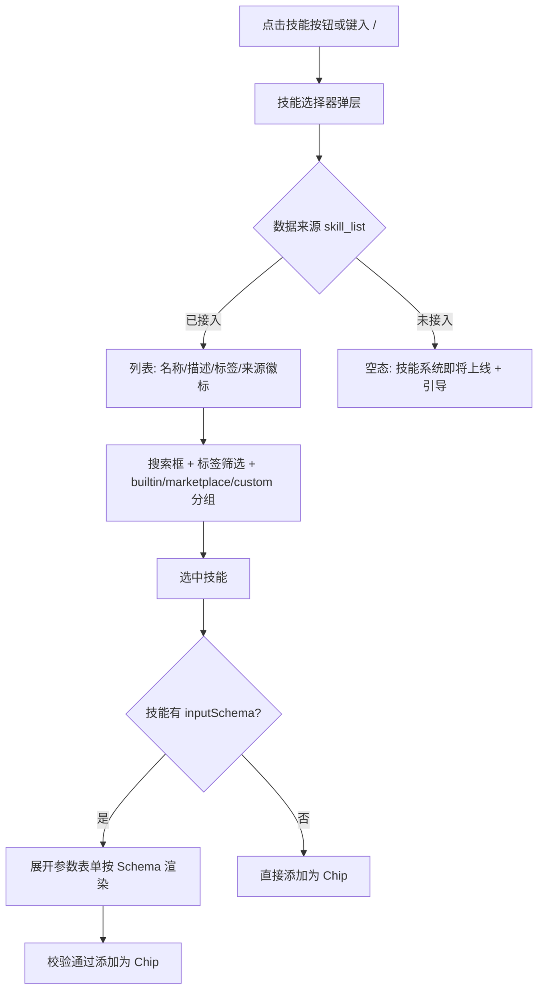
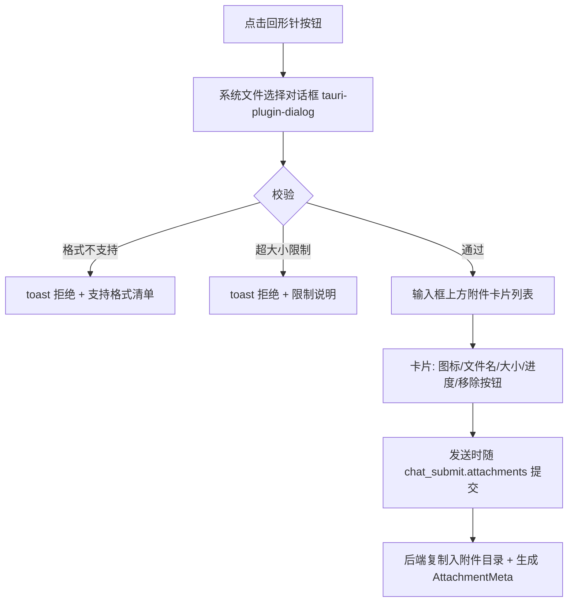
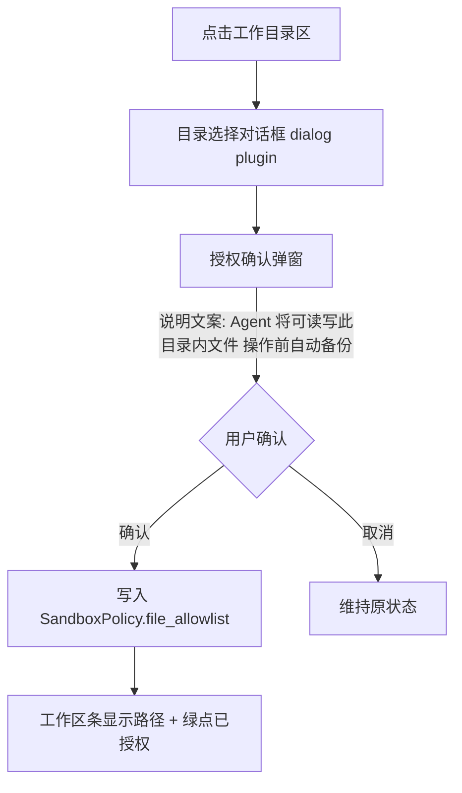
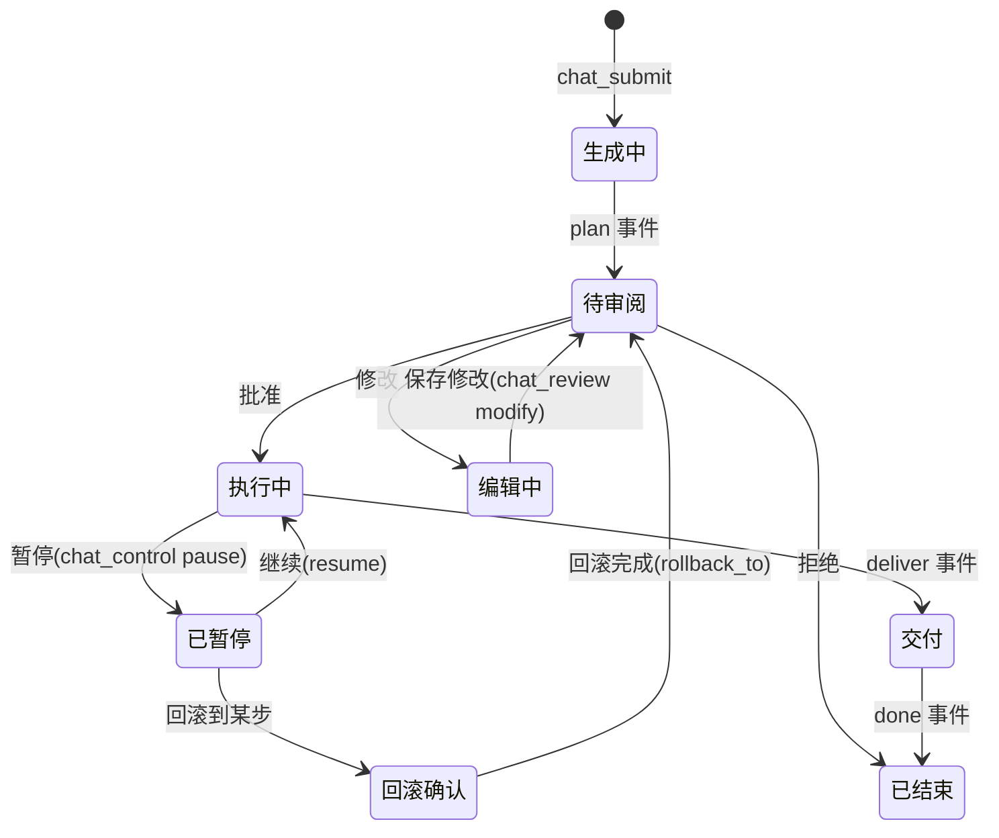

# 通天办公 · Workbench 交互补设计（Feature Spec）

> **文档版本**：v1.0
> **创建日期**：2026-08-05
> **变更目录**：`docs/changes/workbench-interaction/`
> **关联文档**：`docs/spec/spec-通天办公.md` v2.1（§3.1 Agent 引擎、§5 契约）、`docs/spec/spec-通天办公-占位能力清单.md`（§3 组件级专项）
> **范围**：Workbench 对话工作台的五项交互缺口补设计——技能引用、文件上传、工作目录选择、计划审阅/中断/回滚、未实现能力提示规范

---

## 1. 背景

占位能力清单盘点确认 Workbench 输入区存在三项无后端、无交互定义的功能外壳（技能引用/文件上传/工作目录选择），且计划审阅与中断回滚的前端为假实现。本文档补齐交互级定义，作为前端实现与后端 command 排期的依据。

**设计原则**：
1. 所有新交互复用 SPEC §5.1 已定义的 command，不新增契约外接口（确需新增的在本文档标注「契约补充」）
2. 未接入后端的能力一律按 §6 提示规范处理，禁止静默占位
3. 交互文案与视觉沿用既有设计体系（清新蓝 #3FA7F4 / 薄荷绿 #2ED3B7）

---

## 2. 技能引用

### 2.1 入口与触发

| 入口 | 触发方式 |
|------|----------|
| 工具栏技能按钮 | 点击打开「技能选择器」弹层 |
| `/` 命令 | 输入框键入 `/` 弹出内联技能列表（模糊搜索，键盘上下选择） |
| 输入区标签 | 已选技能以 Chip 形式显示在输入框上方，可单独移除 |

### 2.2 技能选择器交互



### 2.3 注入方式（与 Agent 契约联动）

| 模式 | 条件 | 行为 |
|------|------|------|
| **prompt 附加**（默认） | 技能仅含 SKILL.md 指令、无可执行步骤 | 技能内容作为 system prompt 补充随 `chat_submit` 的 goal 上下文传递 |
| **skill_call step** | 技能定义了 `steps`（含工具/脚本） | Planner 生成的 Plan 中插入 `type=skill_call` 步骤；审阅时用户可见该步骤 |

**契约补充**：`ChatSubmitReq` 增加可选字段 `skills: string[]`（引用技能 ID 列表）与 `attachments: AttachmentMeta[]`（见 §3）。

### 2.4 状态与异常

- 技能被禁用（`enabled=false`）：列表中置灰不可选，tooltip「已禁用，前往技能市场启用」
- 技能依赖缺失（`validate` 失败）：选中时提示缺失项，不允许添加
- 多技能引用上限：单次任务最多 3 个，超出提示

---

## 3. 文件上传

### 3.1 两种模式

| 模式 | 入口 | 落位 | 用途 |
|------|------|------|------|
| **附件模式**（默认） | ChatInput 回形针按钮 | 复制至运行目录 `workspaces/{id}/files/attachments/{taskId}/` | 作为本次任务上下文提供给 Agent（读取/分析） |
| **工作区文件模式** | FilePanel「导入」按钮 | 复制至 `workspaces/{id}/files/` | 纳入工作区文件集，可被后续任务反复使用 |

### 3.2 交互流程



### 3.3 约束

| 约束项 | 值 |
|--------|-----|
| 支持格式 | docx/xlsx/pdf/csv/txt/md（与 SPEC §3.3 格式矩阵一致） |
| 单文件大小 | ≤ 50MB |
| 单次数量 | ≤ 10 个 |
| 敏感提示 | 命中 SPEC §6.3 敏感规则的文件，上传时弹出数据分级提示（可继续，记录审计） |

**契约补充**：

```rust
pub struct AttachmentMeta {
    pub file_name: String,      // 原始文件名
    pub staged_path: String,    // 暂存后路径（运行目录内）
    pub size_bytes: u64,
    pub mime: String,
    pub sensitivity: DataSensitivity, // 检测结果
}
```

### 3.4 异常态

- 复制失败（磁盘满/权限）：卡片标红 + 错误码 `BACKUP_FAILED` 对应文案，可重试或移除
- 发送前移除附件：仅移出列表，暂存文件延迟清理
- Web 端（未来云端形态）：附件改为 multipart 上传至云端暂存，交互一致（见云端 spec 可用性维度 degraded）

---

## 4. 工作目录选择

### 4.1 入口

Workbench 顶部工作区条：`当前工作区：{名称} ｜ 工作目录：{路径或「未设置」}`，点击路径区打开选择流程。

### 4.2 交互流程



### 4.3 规则

1. 目录选择是**工作区级**设置（非任务级），切换工作区时各自独立
2. 新目录加入 allowlist 前检查与 blocklist 冲突，冲突时提示并拒绝
3. Agent 的 L0 文件操作范围 = `workspaces/{id}/files/` ∪ 已授权工作目录
4. 更换目录不清空历史授权（保留列表，可单独移除），但当前生效目录仅一个
5. **契约补充**：`workspace_create`/`workspace` 实体增加 `work_dir: Option<String>`；新增 command `workspace_set_dir { workspace_id, dir_path }`（写 allowlist 并发 `workspace://status` 事件）

---

## 5. 计划审阅 / 中断 / 回滚 交互细化

### 5.1 状态机与 UI 映射



### 5.2 审阅（PlanView）

- 步骤列表：序号/名称/类型图标/预计操作说明；`rollbackable` 步骤带可回滚徽标
- **修改模式**：允许删除步骤、调整顺序、编辑 `user_confirm` 类步骤的说明文本；不允许新增步骤（新增需重新提交 goal）——与 `ChatReviewReq.patch: StepPatch[]` 对齐
- 敏感步骤（命中数据分级或危险操作扫描）高亮琥珀色 + 说明
- 批准需点击主按钮；拒绝需二次确认（输入原因可选）

### 5.3 执行中控制条

- 常驻控制条：暂停 / 终止；每步骤行提供「回滚至此」入口（仅 `rollbackable` 步骤，且任务处于 paused 时可用）
- 回滚确认弹窗：展示将被恢复的文件清单（来自回滚栈预览），确认后调用 `chat_control { action: rollback_to, step_id }`
- 回滚过程按钮禁用 + 进度提示；成功后任务回到待审阅状态并刷新 Plan

### 5.4 事件反馈

`agent://event` 事件与 UI 的映射（补充 SPEC §3.1.3 的 UI 侧约定）：

| 事件 | UI 反馈 |
|------|---------|
| `step_start` | 步骤行转 loading + 自动滚动到可见 |
| `step_progress` | 步骤行内流式追加中间输出（可折叠） |
| `step_failed` | 步骤行红色 + 错误文案 + 「重试该步/终止」操作 |
| `deliver` | 产物卡片区（文件卡片可打开/定位到所在目录） |
| `error` | 全局 toast + 任务条错误态，错误码映射文案表 |

---

## 6. 未实现能力提示规范

替代静默占位的统一规范（适用于占位清单中全部「纯占位」项）：

| 元素 | 规范 |
|------|------|
| 按钮/入口 | `disabled` 态 + 透明度 40%；tooltip 统一文案「{能力名} · 即将上线」 |
| 列表页 | 空态插画 + 一句话说明 + （可选）「了解规划」链接指向版本路线 |
| Mock 数据 | 右上角常驻徽标「示例数据」；禁止把 Mock 数据呈现为真实结果 |
| 假实现接口 | 前端调用层（tauri-api）在 dev 模式 console.warn 方法名；prod 模式返回结构化错误 `NOT_IMPLEMENTED`，UI 按禁用态处理 |
| 文案语气 | 中性、不承诺时间；不使用「敬请期待」以外的营销话术 |

---

## 7. 验收要点

| 项 | 验收标准 |
|----|----------|
| 技能引用 | `/` 触发列表、选择、参数表单、Chip 移除全流程可用（skill_list 接入后）；未接入时空态符合 §6 |
| 文件上传 | 三种拒绝路径（格式/大小/数量）均有 toast；附件复制落位正确；敏感文件提示触发 |
| 工作目录 | 授权后写入 allowlist；blocklist 冲突被拒；更换目录不影响历史授权列表 |
| 审阅/回滚 | 状态机全路径无死锁；回滚后文件恢复且 Plan 回到待审阅；事件映射无遗漏 |
| 提示规范 | 全部纯占位项无静默交互（走查清单逐项核对） |

---

*下一步：将本文档与占位清单一起纳入 `/apex-sdd:plan` 的前端任务分解。*
