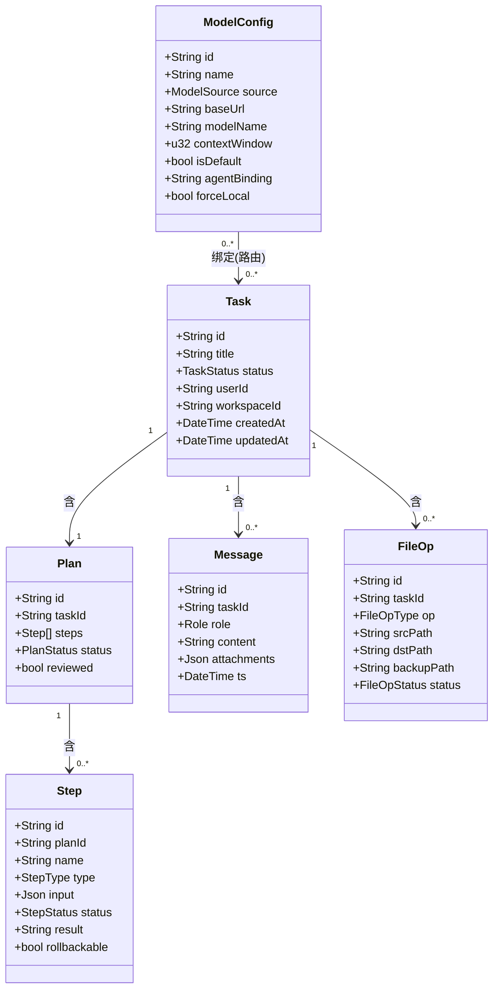
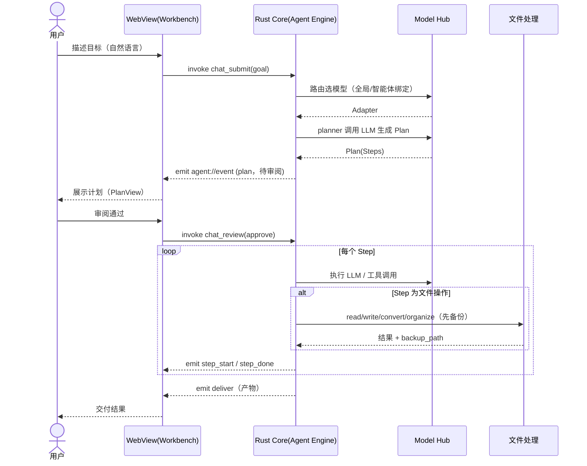
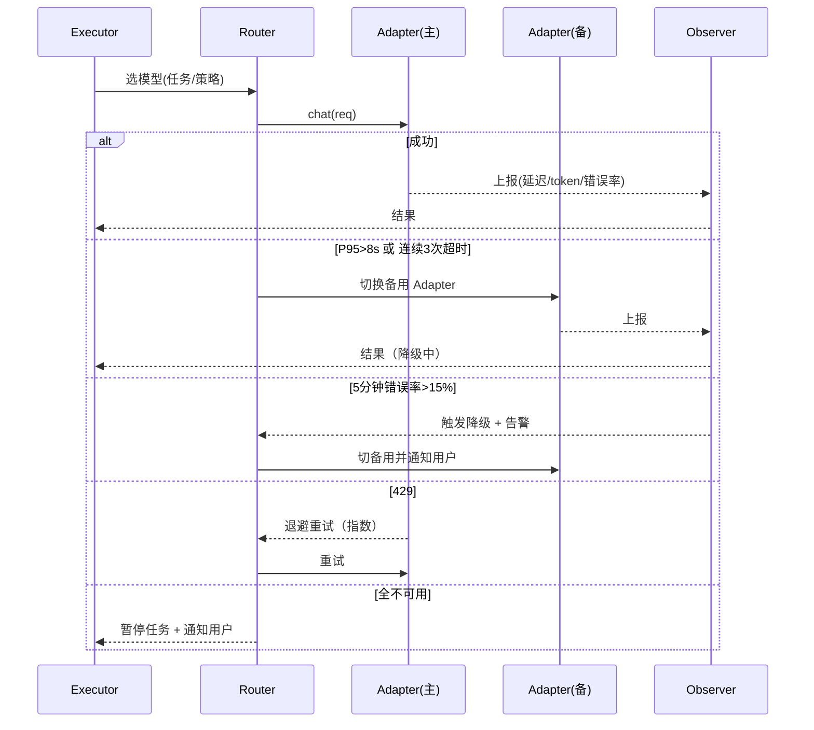

# 通天办公 MVP 系统设计文档（架构师：高见远 / Gao）

> **版本**：v2.1（2026-08-05）
> **架构基调一句话**：以「Tauri 2.x + Rust core 即后端」实现本地优先的最小可行闭环，模型接入采用三层 Model Hub 抽象（接入 / 路由 / 观测），优先交付对话工作台与文件处理两大支柱，并把「自定义模型（OpenAI 兼容 + 本地 Ollama）」作为第二大支柱。Python 仅作个别辅助工具的可选 sidecar，不构成运行时依赖。
> **v2.0 变更说明**：v1.0 基于 Electron 单语言栈；本版随整体架构切换为 Tauri + Rust，详见 `docs/spec/spec-通天办公.md` v2.1 与《Electron → Tauri 架构演进方案》。
> **v2.1 同步**：对齐主 SPEC v2.1 —— 新增运行目录约定（双目录契约）；明确 AgentScope/QwenPaw 仅作设计思路参考、不作运行时依赖。

---

## 1. 实现方案与框架选型

### 1.1 桌面壳：Tauri（结论已由 v1.0 的 Electron 反转）

| 维度 | Electron | Tauri |
| --- | --- | --- |
| 本地文件访问 | 主进程 Node `fs`，生态成熟 | Rust `std::fs` + capability 受控，性能更优 |
| 模型调用 | 主进程 `fetch` 直连 | Rust `reqwest` 直连，支持 SSE 流式 |
| 打包体积 | 较大（约 120MB+） | 极小（约 25MB，压缩后约 12MB） |
| 团队可维护 | 全 TS/JS | 后端 Rust（crate 化模块边界缓解学习曲线），前端仍全 TS |
| 内存占用 | 较高（~300MB） | 低（~120-150MB，系统 WebView 复用） |
| 安全模型 | 需自行收敛 `nodeIntegration` | 默认更严（capability 拒绝制 + 内存安全） |

**结论：选 Tauri 2.x。** 理由（v1.0 三前提已全部反转）：
1. 产品本质是模型 API 编排（HTTP 客户端 + 状态机 + 文件管道），Rust 生态（reqwest/tokio/calamine/docx-rs）已完整覆盖，且性能与内存占用显著更优；
2. 企业分发对体积（< 30MB）与秒开体验有硬性要求，Tauri 安装包约为 Electron 的 1/6；
3. 单二进制分发无运行时依赖，自动更新为单包替换；「Rust 学习曲线」经 crate 化模块边界 + 低并发业务逻辑评估为可控。

**安全加固**：WebView 无任何系统 API 直达能力；capability 白名单仅注册必要 command；文件与子进程操作全部经 Rust 侧受控 command 执行（路径白名单 + 沙箱策略）。

### 1.2 前端框架
Vite + React 18 + TypeScript + MUI + Tailwind。MUI 提供组件库，Tailwind 负责清新视觉（主色 `#3FA7F4` 清新蓝、`#2ED3B7` 薄荷绿，背景 `#F5F9FB`，圆角 10–16px，轻阴影，低认知负荷）。状态用 **Zustand**（轻量全局）配合 **React Query** 管理异步请求。前端与壳框架解耦：仅 IPC 封装层需从 Electron preload 切换为 `@tauri-apps/api` 的 `invoke`/`listen`。

### 1.3 Agent 引擎与后端方案
**推荐：Rust core 即后端（Cargo workspace），Python 仅辅助。**
- Rust core 内承载 Agent 引擎、Model Hub、文件处理、存储；WebView 经 Tauri command/event 调用；
- Rust core 直连模型 API（OpenAI 兼容 / Ollama / 预置云端），文件处理在 Rust 侧完成，避免把文件内容明文外传；
- **Python 定位**：仅作为可选 sidecar（`crates/python-bridge` 管理）承载个别 Rust 生态不成熟的辅助工具（如 docx→pdf 高保真转换、复杂版式解析），**不含任何 Agent 引擎形态**；AgentScope/QwenPaw 仅作设计思路参考，不作为运行时依赖；sidecar 采用 JSON-over-stdio 契约、按需拉起、默认不随安装包分发；Mock 开关开启时由 `MockSidecar` 进程内拦截。

**理由**：避免打包 Python 运行时（体积大、安装复杂）；Rust 单二进制分发；契合本地优先、数据不出域。

### 1.4 模型调用抽象层（Model Hub）三层设计
- **接入层 Adapter**：统一 trait `chat(req)`（async_trait），下挂 `OpenAiCompatAdapter`、`OllamaAdapter`、`PresetAdapter`，负责协议适配、超时、基础重试。
- **路由层 Router**：按「全局默认 / 智能体绑定 / 敏感任务强制本地」选择 Adapter；实现降级熔断。
- **观测层 Observer**：计费（token 计量）、质量（延迟 / 错误率）、日志（审计）。MVP 先实现连通性自测 + 基础成本统计 + 错误率统计 + 降级告警。

---

## 2. 文件列表及相对路径（按模块分组，MVP 约 60 个文件）

```
tongtian-office/
├─ package.json
├─ vite.config.ts
├─ tsconfig.json
├─ tailwind.config.js
├─ postcss.config.js
├─ init.sh / init.ps1             # 初始化脚本（幂等，遵循工程规范）
├─ .env.example                   # 仅示例，严禁真实密钥
├─ src-tauri/                     # Tauri + Rust 后端
│  ├─ Cargo.toml                  # workspace root
│  ├─ tauri.conf.json             # bundle/security/capabilities
│  ├─ capabilities/default.json   # 权限白名单（默认拒绝制）
│  ├─ build.rs
│  ├─ migrations/
│  │  └─ 001_init.sql             # SQLite DDL（tasks/messages/model_configs/...）
│  ├─ src/                        # app 壳 crate
│  │  ├─ main.rs                  # 启动入口、窗口、插件注册
│  │  ├─ state.rs                 # AppState（持有各模块单例）
│  │  └─ commands/
│  │     ├─ chat.rs               # chat_submit/review/control/history
│  │     ├─ file.rs               # file_list/read/preview
│  │     ├─ model.rs              # model_list/add/update/delete/test
│  │     └─ settings.rs           # settings_get/set
│  └─ crates/
│     ├─ agent/                   # Agent 引擎
│     │  └─ src/{lib.rs, engine.rs, planner.rs, executor.rs,
│     │          state.rs, events.rs, types.rs}
│     ├─ model-hub/                # Model Hub
│     │  └─ src/{lib.rs, hub.rs, config.rs, router.rs, observer.rs,
│     │          adapter/{mod.rs, openai_compat.rs, ollama.rs, preset.rs}}
│     ├─ file-ops/                 # 文件处理
│     │  └─ src/{lib.rs, read.rs, write.rs, convert.rs, organize.rs,
│     │          backup.rs, ir.rs}
│     ├─ storage/                  # 持久化与密钥
│     │  └─ src/{lib.rs, db.rs, vault.rs, crypto.rs, entities.rs}
│     ├─ workspace/                # 多智能体工作区（P1 启用）
│     │  └─ src/{lib.rs, manager.rs, runner.rs, acp.rs}
│     ├─ skills/                   # Skills 技能系统（P1 启用）
│     │  └─ src/{lib.rs, loader.rs, registry.rs, manifest.rs, executor.rs}
│     ├─ mcp/                      # MCP 客户端（P1 启用）
│     │  └─ src/{lib.rs, client.rs, security.rs}
│     ├─ sandbox/                  # 三层沙箱（MVP 交付 L0）
│     │  └─ src/{lib.rs, manager.rs, guard.rs, quota.rs}
│     └─ python-bridge/            # 可选 Python sidecar
│        └─ src/{lib.rs, sidecar.rs, mock.rs}
├─ src/                           # React 前端
│  ├─ main.tsx
│  ├─ App.tsx
│  ├─ theme/index.ts              # 清新主题（色板/圆角/阴影）
│  ├─ pages/
│  │  ├─ Workbench.tsx            # 对话工作台
│  │  ├─ ModelHub.tsx             # 模型管理
│  │  └─ Settings.tsx
│  ├─ components/
│  │  ├─ PlanView.tsx             # 计划审阅
│  │  ├─ ChatStream.tsx
│  │  ├─ FilePanel.tsx
│  │  └─ ModelForm.tsx            # 自定义接入表单 + 自测
│  ├─ stores/                     # Zustand 状态
│  └─ lib/
│     └─ ipc.ts                   # @tauri-apps/api invoke/listen 封装
├─ shared/                        # ts-rs 自动生成的 TS 类型
│  ├─ types.ts
│  └─ contracts.ts
├─ python-tools/                  # 可选 Python 辅助脚本（默认不打包）
│  └─ docx2pdf.py
└─ resources/                     # 图标等静态资源
```

---

## 3. 数据结构和接口（类图 / 接口契约）

### 3.1 核心实体（classDiagram）



### 3.2 关键枚举与字段说明
- `TaskStatus`: `idle | planning | executing | delivering | done | failed | rolled_back`
- `PlanStatus`: `draft | pending_review | approved | rejected | executing | done`
- `StepStatus`: `pending | running | success | failed | skipped | rolled_back`
- `StepType`: `llm_call | file_read | file_write | file_convert | file_organize | user_confirm`
- `ModelSource`: `openai_compat | ollama | preset_qwen | preset_deepseek | preset_openai`
- `Role`: `user | assistant | system | tool`
- `FileOpType`: `read | write | convert | organize`

实体以 Rust struct 定义（serde + `ts-rs` 导出至 `shared/`），SQLite 持久化由 `crates/storage` 承担；`ModelConfig` 的 API Key 不进 struct 明文字段，经 keyring 系统密钥库存储。

### 3.3 前后端 ↔ 模型 API 关键接口（请求/响应示例）

**（a）前端 → Rust core：发起任务（command `chat_submit`）**

```ts
// 请求（invoke）
{ task_id?: string; goal: string; model_binding?: string }
// 响应（即时）
{ task_id: string }
// 流式事件（listen "agent://event"，逐事件推送）
{ type: "plan"; plan: Plan }
{ type: "step_start"; step_id: string }
{ type: "step_done"; step_id: string; result: string }
{ type: "deliver"; artifacts: FileOp[] }
{ type: "done"; task_id: string }
```

**（b）前端 → Rust core：计划审阅（command `chat_review`）**

```ts
{ plan_id: string; action: "approve" | "reject" | "modify"; patch?: StepPatch[] }
```

**（c）前端 → Rust core：中断 / 回滚（command `chat_control`）**

```ts
{ task_id: string; action: "pause" | "resume" | "rollback_to"; step_id?: string }
```

**（d）Rust core → 模型 API（Adapter 统一契约）**

```rust
struct ChatRequest {
    messages: Vec<ChatMessage>,
    model: String,
    temperature: Option<f32>,
    max_tokens: Option<u32>,
    stream: bool,
}
struct ChatResponse {
    content: String,
    usage: TokenUsage,   // prompt_tokens / completion_tokens
    latency_ms: u64,
    model: String,
}
```

**（e）自定义模型接入 + 连通性自测（command `model_test`）**

```ts
// 请求
{ base_url: string; api_key: string; model_name: string; context_window: number }
// 响应
{ ok: boolean; latency_ms: number; model: string; error?: string }
```

---

## 4. 程序调用流程（时序图）

### 4.1 用户发指令 → 规划 → 执行 → 交付 主流程



### 4.2 模型接入 / 路由 / 降级 调用流程



---

## 5. 任务列表（有序、含依赖、按实现顺序）

| 任务ID | 名称 | 依赖 | 预计产出文件 | 验收要点 |
| --- | --- | --- | --- | --- |
| T0 | 工程脚手架与 Tauri 壳 | 无 | `package.json`,`vite.config.ts`,`src-tauri/*`,`src/` 骨架,`theme/index.ts` | `tauri dev` 可启动，WebView 渲染清新界面；command 通道通；capability 默认拒绝制生效 |
| T1 | 契约与类型同步管线 | T0（可并行） | `crates/*/types.rs` + ts-rs 配置 + `shared/` | 前端引用自动生成类型编译通过；契约覆盖对话/文件/模型 |
| T2 | 本地加密存储与持久化 | T0 | `crates/storage/{db.rs,vault.rs,crypto.rs}` | 模型 Key 不以明文落盘（keyring 引用）；读取需解密；任务/会话可持久化 |
| T3 | Model Hub 接入层 | T2 | `crates/model-hub/{hub.rs,config.rs,adapter/*}` | OpenAI 兼容 + Ollama + 预置云端均可 chat；`model_test` 连通性自测可用 |
| T4 | Model Hub 路由层 + 观测层 | T3 | `crates/model-hub/{router.rs,observer.rs}` | 全局默认/智能体绑定/敏感强制本地生效；注入故障触发降级与告警；成本/错误率统计正确；429 退避 |
| T5 | 模型管理 UI | T3,T4,T1 | `ModelHub.tsx`,`ModelForm.tsx`,`Settings.tsx` | 填表即接（BaseURL+Key+模型名+上下文长度）并自测通过；可设默认/绑定智能体 |
| T6 | 文件读/写/转换/整理 | T2 | `crates/file-ops/{read,write,convert,organize,backup}.rs` | 覆盖 docx/xlsx/pdf/csv/txt ≥5 种；转换抽样准确率 ≥98%；操作前备份 |
| T7 | Agent 引擎-规划 | T1,T3 | `crates/agent/{planner.rs,engine.rs,state.rs,types.rs}` | 给定目标产出结构化 Plan（含可审阅 Step）；状态机非法转移被拒 |
| T8 | Agent 引擎-执行与交付 | T7,T6 | `crates/agent/executor.rs,events.rs` | 按 Step 执行（调模型/文件）；可中断、可回滚到指定步；产物可交付；事件流经 `agent://event` 推送 |
| T9 | 工作台 UI（端到端） | T5,T7,T8,T1 | `Workbench.tsx`,`PlanView.tsx`,`ChatStream.tsx`,`FilePanel.tsx` | 走通规划→执行→交付；可审阅/干预/回滚；文件面板可用 |
| T10 | 错误处理、日志与审计约定 | T0 | tracing 全局配置 + `AppError` 映射 | 统一错误码与日志格式；关键操作（模型调用/文件写/路由切换）有日志与审计埋点；敏感信息脱敏 |
| T11 | 端到端联调与 MVP 验收 | T9,T4,T6 | 联调报告、演示脚本、三平台安装包 | 成功指标基线就绪：一次完成率、留存埋点、自定义模型接入可演示；体积/启动达标 |

> 实现顺序建议：T0 → T1/T2 → T3 → T4 → T5 → T6 → T7 → T8 → T9 → T10（T10 可并行穿插）→ T11。T1 与 T2 可与 T0 并行以提速。

---

## 6. 依赖包列表（必须 vs 可选）

### 桌面壳 / 运行时（必须）
- `tauri` 2.x + `tauri-cli`：桌面壳与构建
- `tauri-plugin-dialog`、`tauri-plugin-notification`、`tauri-plugin-updater`：原生对话框 / 通知 / 自动更新

### Rust core（必须，Cargo workspace）
- `tokio`：异步运行时；`reqwest`：HTTP/SSE；`serde`/`serde_json`：序列化
- `thiserror`/`anyhow`：错误处理；`tracing`/`tracing-subscriber`：结构化日志
- `rusqlite`（bundled）：本地持久化；`keyring`：系统密钥库；`aes-gcm`/`argon2`：加解密
- `calamine`/`rust_xlsxwriter`：xlsx 读写；`docx-rs`：docx；`pdf-extract`/`lopdf`：pdf；`csv`：csv；`pulldown-cmark`：markdown
- `uuid`/`chrono`：工具；`regex`：敏感数据与危险命令检测；`ts-rs`：TS 类型导出

### 前端（必须）
- `react`,`react-dom`,`typescript`,`vite`,`@vitejs/plugin-react`
- `@tauri-apps/api`,`@tauri-apps/cli`：Tauri 前端绑定
- `@mui/material`,`@emotion/react`,`@emotion/styled`：组件库
- `tailwindcss`,`postcss`,`autoprefixer`：清新样式
- `zustand`：轻量状态；`@tanstack/react-query`：异步请求管理（可选但推荐）
- `react-markdown`：渲染模型 Markdown 输出

### 测试（必须）
- Rust：`mockall`,`wiremock`,`tempfile`,`cargo-llvm-cov`
- 前端：`vitest`；E2E：`tauri-driver`

### 可选 / 后续
- `rmcp`：MCP 客户端（P1 启用）
- `tokio-cron-scheduler`：定时任务（P1）
- `headless_chrome`/`enigo`/`xcap`：浏览器自动化 / 桌面控制 / 截图（P1）
- `python-bridge` 相关：`python-build-standalone`（用户可选装，不随基础包分发）
- 向量库（sqlite-vec 等）：跨会话记忆（MVP 不在范围，留接口）

---

## 7. 共享知识（跨文件约定）

- **目录约定**：`src-tauri/crates/` 下按能力域划分 crate，`src/` 前端，`shared/` 为 ts-rs 自动生成的共享类型（禁止手改）；新增模块在对应 crate 下建子模块，不在根散落文件。
- **命名规范**：
  - Rust：模块/函数 snake_case，类型 PascalCase；crate 命名 `tongtian-{域}`（包名）/ `crates/{域}`（目录）；
  - 前端组件：PascalCase（`PlanView.tsx`）；工具/模块：kebab-case；
  - Tauri command 统一 `domain_action`（如 `chat_submit`、`model_test`）；event 统一 `domain://name`（如 `agent://event`）。
- **状态管理**：前端用 Zustand 管全局 UI 状态、React Query 管异步；Rust core 状态经 `AppState` 持有各模块单例（`tauri::State` 注入 command）。
- **错误处理与日志**：统一错误结构 `AppError { code, message, details? }`（见 SPEC §5.3）；前端 toast 提示，Rust 侧 tracing 落日志；日志分级 `debug/info/warn/error`，写入用户数据目录，敏感字段（Key、文件路径中的用户名）脱敏；模型调用、文件写、路由切换必留审计。
- **配置（敏感信息）存储**：模型 Key 经 keyring/系统密钥库加密，绝不明文、绝不硬编码、绝不进 `.env` 真实值；`.env.example` 仅放占位；SQLite 仅存 `api_key_ref` 引用名；提供「出域合规硬开关」接口占位（MVP 不实现完整版）。
- **运行目录约定**（对齐 SPEC v2.1 §4.4 双目录契约）：安装目录只读；全部用户数据位于运行目录（默认 `%USERPROFILE%\.tongtian-office`，可由 `TONGTIAN_HOME` 覆盖），子目录 `bin/skills/mcp/workspaces/backups/db/logs/config`；Rust 侧路径解析统一经 `crates/storage::paths`，禁止各模块自行拼接；数据库、日志、备份、技能、记忆均落此目录。
- **自研优先**：Agent 引擎与核心能力 Rust 自研；QwenPaw/AgentScope 仅作设计思路参考，不作运行时依赖、不复制代码；开发期临时 Python 引擎（engine/server.py）随 `crates/agent` 落地后下线。
- **Mock 开关规范**（遵循项目开发规范）：外部接口（模型 API/Ollama/MCP/sidecar）依赖均以 `MOCK_ENABLED=true`（默认，开发阶段）+ cargo feature `mock` 切换为本地模拟实现；联调阶段置 `MOCK_ENABLED=false` 调用真实接口。
- **初始化脚本规范**（遵循项目开发规范）：根目录 `init.sh`（配套 `init.ps1`）幂等完成依赖安装（`cargo fetch` + `npm install`）、按 Mock 开关启动 `npm run tauri dev`、输出访问信息（dev server 地址 / 运行模式 / 日志目录）。

---

## 8. 待明确事项（需主理人/用户拍板）

1. **跨会话记忆**：MVP 明确不在范围，但是否引入向量库（sqlite-vec）、用哪种嵌入模型，需提前定调以预留接口（建议 MVP 仅做简单最近会话检索占位）。
2. **规划范式**：MVP 建议采用 **Plan-and-Execute**（先出计划供审阅，契合「计划审阅」需求），而非纯 ReAct；是否允许模型走原生 function calling 需确认。
3. **本地模型最低硬件**：Ollama 跑 7B/14B 的显存与内存门槛未定，影响「敏感任务强制本地」的可承诺范围——需主理人确认目标机型。
4. **Agent 粒度**：MVP 建议单一通用 Agent + 可绑定模型，多工作区编排列为 P1（crates/workspace 已预留）。
5. **文件转换准确率 ≥98% 的验收**：测试用例集来源与判定标准需明确（建议内置样例集 + 人工抽检）；docx→pdf 高保真转换依赖 python-bridge 可选扩展，验收口径需区分「纯 Rust 保底」与「扩展增强」。
6. **出域合规策略**：MVP 仅留硬开关接口占位；数据分级、出域白名单由谁定义、何时启用需产品侧定。
7. **预置云端鉴权**：用户自备 Key 还是平台统一 Token？影响 `preset` Adapter 与计费口径。
8. **回滚粒度**：文件操作回滚采用「操作前备份原文件」（已定，简单可靠）；是否升级为 git-like 快照待 P2 评估。
9. **Rust 团队能力建设**：阶段 1 需 2-3 名可交付 Rust 工程师，人力缺口与外部支援需提前确认。

---

> 本设计不编写任何实现代码，仅做架构选型、契约设计与任务分解，供工程师直接落地。
